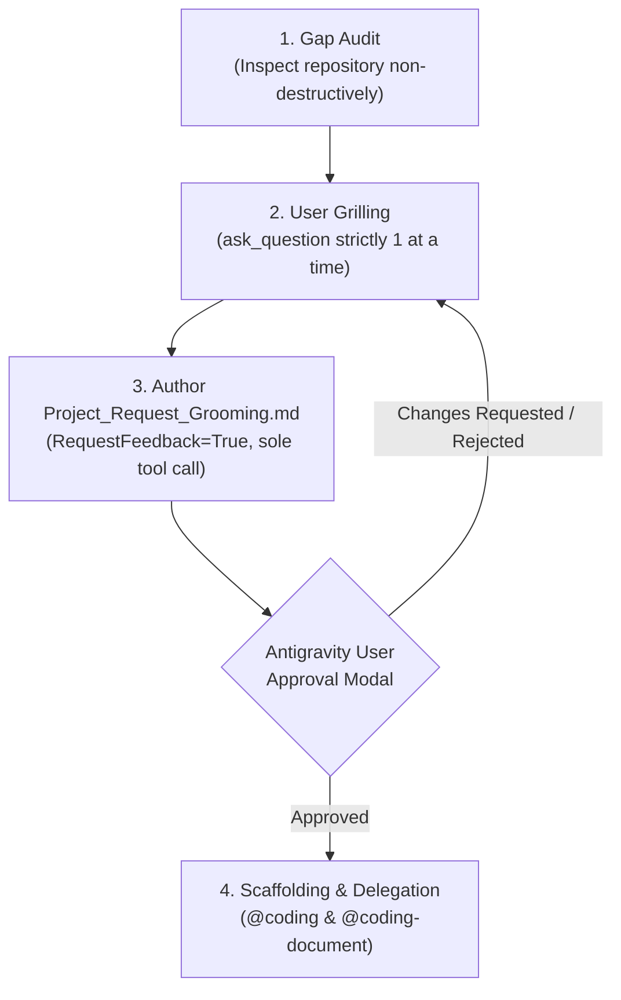

# agentic-project-grooming-plugin

Interactive project grooming, requirement clarification, repository gap analysis, and workspace scaffolding plugin for [Google Antigravity](https://antigravity.google).

---

## Overview

`agentic-project-grooming-plugin` provides structured, interactive project grooming and scoping for new or existing workspaces. It conducts a non-destructive gap analysis of existing repositories, interrogates the user across 7 core dimensions using Matt Pocock-style one-question-at-a-time grilling, generates an approval-gated `Project_Request_Grooming.md` artifact, and seamlessly orchestrates workspace scaffolding and documentation delegation to companion plugins (`@coding` and `@coding-document`).

---

## Features

- **Declarative Subagent (`@coding-groom`)**: Dedicated grooming specialist configured in [`agents/coding-groom/agent.md`](file:///Users/gpfister/Development/Projects/gpfister/agentic/agentic-project-grooming-plugin/agents/coding-groom/agent.md) (aliases: `@coding-groom`, `@coding-project-grooming`).
- **Progressive Skill (`project-grooming`)**: Comprehensive 4-step workflow defined in [`skills/project-grooming/SKILL.md`](file:///Users/gpfister/Development/Projects/gpfister/agentic/agentic-project-grooming-plugin/skills/project-grooming/SKILL.md).
- **Matt Pocock Style Grilling**: Strictly **one question at a time** via `ask_question`, drilling into assumptions, edge cases, and architectural specifics.
- **7-Dimension Scope Analysis**:
  1. **Project Identification**: Name, tagline, and core problem statement.
  2. **Goals & Target Audience**: User personas, core user journeys, MVP boundaries.
  3. **Known Restrictions & Standards**: Target OS, runtime/framework versions, compliance standards.
  4. **Repository Topology**: Monorepo, polyrepo, standalone repository, git sub-repos, branch conventions.
  5. **Licensing**: SPDX license identifiers, copyright holder, copyright year.
  6. **Documentation Requirements**: Obsidian vault structure, architecture specifications, ADR templates.
  7. **Workspace Tooling**: Package managers (`uv`, `npm`), Makefile automation, CI/CD pipelines.
- **Interactive Approval Gate**: Produces `Project_Request_Grooming.md` as the sole and final tool call of the turn with `RequestFeedback=True`, requiring explicit user confirmation before scaffolding.
- **Cross-Plugin Scaffolding & Archival Delegation**: Automatically hands off scaffolding execution to `@coding` and documentation archival to `@coding-document`, with robust standalone local fallbacks.

---

## Installation & Activation

```bash
# Install plugin via Antigravity CLI:
agy plugin install agentic-project-grooming-plugin

# Or enable in current session:
agy plugin enable agentic-project-grooming-plugin
```

---

## Usage

You can trigger project grooming either via subagent invocation or natural language prompts:

```text
@coding-groom Groom our new multi-repository data orchestration workspace.
```

Or ask naturally:
- *"I'd like to groom a new microservices project with a shared Obsidian vault."*
- *"Audit this repository, identify missing configs and licenses, and help me groom the project scope."*

---

## Approval Gate Workflow



> [!IMPORTANT]
> The creation of `Project_Request_Grooming.md` is strictly enforced as the **sole and final tool call** in its turn. Antigravity requires this isolation so the interactive **Approve / Reject** buttons render cleanly for the user.

---

## Companion Plugin Interoperability Matrix

`agentic-project-grooming-plugin` dynamically inspects active workspace plugins and adapts its handoff behavior:

| Companion Plugin | Integration Target | Behavior when Installed | Graceful Standalone Fallback |
| :--- | :--- | :--- | :--- |
| **`agentic-coding-plugin`** | `@coding` | Invokes `@coding` to initialize git sub-repos, create `Makefile`, author automation scripts, apply licensing, and scaffold boilerplate code according to `Project_Request_Grooming.md`. | Executes direct local scaffolding of root files, manifests, `.gitignore`, and `Makefile`. |
| **`agentic-document-plugin`** | `@coding-document` | Invokes `@coding-document` to initialize the `<project>-obsidian/` knowledge vault, document architecture designs, and seed initial ADRs. | Creates standard markdown documentation under `docs/` or `<project>-obsidian/` with initial architecture notes and ADR templates. |

---

## License

This project is licensed under the [MIT License](file:///Users/gpfister/Development/Projects/gpfister/agentic/agentic-project-grooming-plugin/LICENSE).
