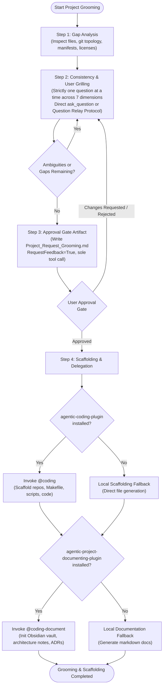

# Project Grooming & Clarification Skill (`project-grooming`)

The `project-grooming` skill guides users through an interactive, rigorous project scoping and repository assessment process. It conducts a non-destructive gap analysis of existing workspaces, interrogates the user across 7 core dimensions using Matt Pocock-style one-question-at-a-time grilling, generates an approval-gated `Project_Request_Grooming.md` artifact, and orchestrates scaffolding handoffs to companion plugins (`@coding` and `@coding-document`).

---

## Workflow Overview



---

## Detailed 4-Step Workflow

### Step 1: Gap Analysis & Repository Audit
Before interacting with the user, perform a fast, non-destructive audit of the workspace:
1. **Directory Structure & Git Inspection**:
   - Inspect top-level directory contents using `list_dir`.
   - Check if the workspace is a git repository (`git status`, `.git/`), a monorepo, or an orchestration workspace containing standalone sub-repositories.
   - Inspect `.gitignore` for standard exclusions (Python, Node, OS files, build artifacts).
2. **Project Manifests & Dependencies**:
   - Detect existing language and package manifests: `pyproject.toml`, `uv.lock`, `package.json`, `Cargo.toml`, `go.mod`, etc.
   - Note runtime environments and dependency managers in use.
3. **Licensing & Legal Compliance**:
   - Verify presence of `LICENSE` or `COPYING` file and SPDX identifier.
   - Identify author and copyright headers.
4. **Documentation & Knowledge Base**:
   - Check for `README.md`, `CONTRIBUTING.md`, architectural documentation, and Obsidian vaults (`<project>-obsidian/` or `agentic-obsidian/`).
5. **Workspace Automation & Hygiene**:
   - Inspect `Makefile`, task runners, build scripts, linters (`ruff`, `eslint`), and CI/CD pipelines (`.github/workflows/`).
6. **Compile Internal Gap Assessment**:
   - Summarize what exists, what is missing, and what appears ambiguous to drive the subsequent interrogation.

---

### Step 2: Consistency & User Grilling (Matt Pocock Style)
Engage the user in an iterative interrogation, grilling relentlessly until every ambiguity is resolved.

> [!IMPORTANT]
> **Strict Rule**: Always ask **strictly one question at a time**. Never ask composite or multi-part questions in a single turn.

#### Dual-Mode Interrogation (Question Relay Protocol)
To ensure reliable operation whether invoked standalone or delegated under an orchestrator subagent, project grooming supports two interrogation modes:

1. **Standalone Root Agent Mode**:
   - When running directly as the root conversational agent with the user, call `ask_question` directly for each inquiry.
2. **Delegated Subagent Mode (Question Relay Protocol)**:
   - When invoked as a subagent under a caller orchestrator (e.g. `@coding`):
     * Do NOT call `ask_question` directly, ensuring orchestrator conversational flow and approval context remain unified.
     * Relay questions strictly one at a time via `send_message` to the caller using the `[QUESTION_RELAY_REQUEST]` envelope:
       ```text
       [QUESTION_RELAY_REQUEST]
       Question: <Precise question text>
       Options: <Optional list of choices or 'Free text'>
       Context: <Brief explanation of why this question is being asked>
       ```
     * Await the response envelope from the caller before moving to the next question or subsequent dimension:
       ```text
       [QUESTION_RELAY_RESPONSE]
       Answer: <User's response relayed by caller>
       ```

#### 7 Core Dimensions for Interrogation
Interrogate across the **7 Core Dimensions**:

1. **Project Identification**:
   - What is the definitive project/workspace name?
   - What is the concise one-sentence value proposition or tagline?
   - What core problem does this project solve?
2. **Goals & Target Audience**:
   - Who are the primary end-user personas (e.g. developers, data engineers, CLI operators)?
   - What are the key user journeys or core workflows?
   - What constitutes the Minimum Viable Product (MVP) vs future roadmap?
3. **Known Restrictions & Standards**:
   - What target platforms and operating systems must be supported (macOS, Linux, Windows)?
   - What runtime versions (e.g. Python 3.11+, Node 20 LTS) and framework restrictions apply?
   - Are there specific security, architectural, or enterprise compliance constraints?
4. **Repository Topology**:
   - Should the repository be structured as a standalone repository, a monorepo, or a multi-repo orchestration layout with independent git sub-repos?
   - What branch convention should be followed (`master`/`main`, `feature/*`, `task/*`)?
5. **Licensing**:
   - What open source or proprietary license will govern the code (MIT, Apache 2.0, GPLv3, Proprietary)?
   - Who is the designated copyright holder and what copyright year applies?
6. **Documentation Requirements**:
   - Should documentation live in an Obsidian vault (e.g., `<project>-obsidian/`)?
   - What document artifacts are required (System Architecture diagrams, ADRs, user guides, API references)?
7. **Workspace Tooling**:
   - Which package and dependency managers should be configured (`uv`, `poetry`, `pnpm`, `npm`)?
   - What automation targets belong in the workspace `Makefile` (`sync`, `test`, `lint`, `format`, `clean`)?
   - What CI/CD automation is required?

Continue grilling one question at a time until all 7 dimensions are fully clarified.

---

### Step 3: Approval Gate Artifact (`Project_Request_Grooming.md`)
Synthesize the complete groomed specification into a formal artifact.

1. **Author the Artifact**:
   - Write `Project_Request_Grooming.md` into `<appDataDir>/brain/<conversation-id>/Project_Request_Grooming.md`.
   - Include standard sections:
     - **Executive Summary & Identification**: Name, tagline, problem statement.
     - **Goals & User Journeys**: Target personas, key capabilities, acceptance criteria.
     - **Architecture & Technical Standards**: Runtimes, frameworks, constraints.
     - **Repository Topology**: Git structure, sub-repos, branch strategy.
     - **Licensing & Copyright**: License type, copyright owner.
     - **Documentation & Vault Strategy**: Obsidian layout, ADR conventions.
     - **Tooling & Task Automation**: Makefile commands, test harnesses, linters.
     - **Scaffolding Implementation Plan**: Step-by-step execution roadmap.
2. **Strict Gate Tool Call Rule**:
   - The tool call `write_file` with `ArtifactMetadata={"RequestFeedback": True, "UserFacing": True, "Summary": "..."}` must be the **sole and final tool call** of that turn.
   - Do NOT batch any other tool calls (e.g., `run_command` or secondary `write_file`) in the same turn.
3. **Await User Approval Gate**:
   - **If Approved (`[GATE_APPROVED]`)**: Advance immediately to Step 4 (Scaffolding & Delegation).
   - **If Rejected or Comments Provided**: Acknowledge the feedback and return to Step 2 to grill and clarify the specific modification requests before regenerating the artifact.

---

### Step 4: Scaffolding & Delegation
Once `Project_Request_Grooming.md` is approved, execute or delegate scaffolding based on installed companion plugins:

#### 1. Scaffolding Delegation (`@coding`)
- **Detection**: Check if `agentic-coding-plugin` is installed in the workspace (or available via skills/agents).
- **If Installed**:
  - Invoke `@coding` orchestrator:
    ```python
    invoke_subagent(
        TypeName="coding",
        Role="Coding Workflow Orchestrator",
        Prompt="Execute workspace scaffolding according to approved grooming artifact at <appDataDir>/brain/<conversation-id>/Project_Request_Grooming.md. Initialize repositories, Makefile targets, .gitignore, licenses, and base code templates."
    )
    ```
- **If Not Installed (Local Fallback)**:
  - Generate the approved repository topology locally using `run_command` and `write_file`.
  - Create `.gitignore`, `LICENSE`, `Makefile`, and base config files directly.

#### 2. Documentation Delegation (`@coding-document`)
- **Detection**: Check if `agentic-project-documenting-plugin` is installed in the workspace.
- **If Installed**:
  - Invoke `@coding-document`:
    ```python
    invoke_subagent(
        TypeName="coding-document",
        Role="Documentation Specialist",
        Prompt="Initialize project Obsidian vault and record architecture specifications, ADRs, and project overview notes based on <appDataDir>/brain/<conversation-id>/Project_Request_Grooming.md."
    )
    ```
- **If Not Installed (Local Fallback)**:
  - Create standard markdown documentation directly under `docs/` or `<project>-obsidian/` with initial architecture notes and ADR templates.

---

## Usage Examples

- Prompt: *"Groom my new workspace for an event-driven microservices platform."*
- Prompt: *"Run project grooming on this repository and analyze missing components."*
- Invocation: `@coding-groom Clarify requirements and scaffold our multi-repo agent ecosystem.`
